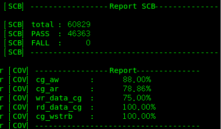
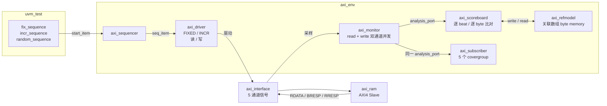

# AXI4 RAM UVM 验证环境

> **30 秒摘要**：这是一个从 0 搭建的 AXI4 Slave UVM 验证项目，完整打通「激励生成 → 总线驱动 → 并发采集 → 参考模型 → 字节级比对 → 功能覆盖率」闭环。
>
> 我重点解决了 AXI 验证里最容易出问题的三件事：**5 个通道的并发采集与 burst 重组**、**WSTRB 字节掩码建模**、**无 RSTRB 条件下的窄传输比对**。
>
> **能力关键词**：UVM 全链路 · AXI4 协议 · 参考模型 · 功能覆盖率 · Debug

<p>
  
  
  
  
  
</p>

[GitHub 仓库](https://github.com/K-BreezeMu/axi_ram) · [验证架构](#验证架构) · [关键设计](#三个关键设计) · [测试与结果](#测试与结果) · [快速开始](#快速开始)

---

## 项目名片

| 项目 | 内容 |
| --- | --- |
| 项目类型 | 数字 IC 验证个人项目 / UVM 实战 |
| 项目时间 | 2026.10 – 2026.11 |
| 我的角色 | 独立完成验证环境、测试用例、Debug 与文档 |
| 待测设计 | `axi_ram`：AXI4 Block RAM Slave，16-bit 地址、32-bit 数据、8-bit ID、4-bit WSTRB |
| 验证方法 | UVM 1.2、约束随机（CRV）、参考模型、scoreboard、covergroup |
| 代码规模 | 约 **1.4k 行验证代码**，20 个 SystemVerilog 文件；DUT 约 1.1k 行 |
| 仿真工具 | Synopsys VCS + Verdi，Makefile 管理编译、回归与波形 |
| 项目状态 | 环境闭环可运行；覆盖率与断言仍在持续完善 |

---

## 先看结果

| 指标 | 结果 |
| --- | --- |
| 测试用例 | FIXED、INCR、200 轮随机，共 3 条主测试 |
| 比对粒度 | 读事务逐 beat、逐 byte 比对，覆盖 1/2/4 字节传输 |
| 仿真结果 | 仓库记录的报告为 **FALL = 0** |
| 功能覆盖率 | `cg_aw` 88.00% · `cg_ar` 78.86% · `wr_data_cg` 75.00% · `rd_data_cg` 100% · `cg_wstrb` 100% |
| 典型调试 | 握手竞争、INCR 地址截断、Monitor 句柄复用 3 类问题 |



> 数据来自仓库中的 `coverage.png` 仿真截图；覆盖率会随随机种子和用例变化。
>
> 说明：截图中的 `total` 按字节计数，`PASS` 只统计字内有效 lane；跨字边界字节当前会被跳过，因此两者不相等，详见「已知限制」。

---

## 工程亮点

| 亮点 | 我做了什么 | 体现的能力 |
| --- | --- | --- |
| **完整 UVM 闭环** | 从 interface、transaction、sequencer、driver、monitor，到 refmodel、scoreboard、subscriber、env/test，全部打通 | UVM 树形结构、TLM、factory、config_db、phase 机制 |
| **Monitor 真正并发** | 用 `fork...join` 同时监控写通道（AW/W/B）和读通道（AR/R），按 VALID/READY 握手把物理信号重组成完整 burst | AXI4 五通道协议、并发采集、事务重组 |
| **字节级参考模型** | 用关联数组按 byte 存储，写操作严格按 `WSTRB` 更新，FIXED/INCR 分别推进地址 | 参考模型独立实现、字节掩码、地址对齐 |
| **窄传输比对** | 读通道没有 `RSTRB`，根据 `ARSIZE` 与地址计算有效 lane，对 32-bit 读数据做字节切片比对 | 协议细节理解、mask 比对、边界分析 |
| **约束随机 + 定向补盲** | 200 轮随机读写，约束覆盖 4KB 边界、最大 256 beat、size/burst/address 分布，并补 WSTRB/数据模式定向用例 | CRV、覆盖率驱动验证、corner case 设计 |
| **工程化交付** | Makefile 一键编译/回归、Verdi 波形、清晰的目录分层与 README | 脚本化、可复现、文档能力 |

---

## 我掌握的能力

| 能力维度 | 对应实践 |
| --- | --- |
| **UVM 方法学** | 独立搭建 agent / env / sequence / sequencer / driver / monitor / scoreboard / subscriber；理解 phase、objection、config_db、analysis port |
| **AXI4 协议** | 熟悉 AW/W/B/AR/R 五通道握手、FIXED/INCR burst、WSTRB、WLAST/RLAST、4KB 边界、窄传输与地址对齐 |
| **验证平台开发** | 事务建模与随机约束、driver 时序驱动、monitor 并发采样、TLM 连接、参考模型与 scoreboard |
| **覆盖率驱动验证** | 设计 5 个 covergroup，覆盖 burst 类型、size、len、地址区间、数据模式与 WSTRB 组合 |
| **Debug 能力** | 从 mismatch 反查协议时序、地址计算和 SV 语义问题；用波形 + 日志定位竞争与句柄复用 |
| **工程化** | VCS/Makefile 流程、Verdi 调试、Git 版本管理、技术文档写作 |

---

## 验证架构



**一句话数据流**：sequence 产生事务 → sequencer 调度 → driver 转成引脚时序 → DUT 响应 → monitor 采集并重组 → scoreboard 与 refmodel 比对，同时 subscriber 采样覆盖率。

### 组件职责

| 组件 | 关键文件 | 职责 |
| --- | --- | --- |
| `axi_interface` | [`axi_interface.sv`](https://github.com/K-BreezeMu/axi_ram/blob/main/component/axi_interface.sv) | 声明 AXI4 五通道信号，连接 DUT 与 TB |
| `axi_transaction` | [`axi_transaction.sv`](https://github.com/K-BreezeMu/axi_ram/blob/main/component/axi_transaction.sv) | 定义读写事务、burst 字段、`wdata/wstrb` 队列及地址约束 |
| `axi_sequencer` | [`axi_sequencer.sv`](https://github.com/K-BreezeMu/axi_ram/blob/main/component/axi_sequencer.sv) | 标准 UVM sequencer |
| `axi_driver` | [`axi_driver.sv`](https://github.com/K-BreezeMu/axi_ram/blob/main/component/axi_driver.sv) | 驱动 FIXED/INCR 读写、复位；完成 VALID/READY 握手并检查 BID/RLAST |
| `axi_monitor` | [`axi_monitor.sv`](https://github.com/K-BreezeMu/axi_ram/blob/main/component/axi_monitor.sv) | 双通道并发采样，组装完整 burst；检查 WLAST 后通过 analysis port 广播 |
| `axi_refmodel` | [`axi_refmodel.sv`](https://github.com/K-BreezeMu/axi_ram/blob/main/component/axi_refmodel.sv) | 按 byte 维护理想 RAM，处理 WSTRB、FIXED/INCR 地址推进 |
| `axi_scoreboard` | [`axi_scoreboard.sv`](https://github.com/K-BreezeMu/axi_ram/blob/main/component/axi_scoreboard.sv) | 写事务更新参考模型；读事务按有效 lane 做字节级比对 |
| `axi_subscriber` | [`axi_subscriber.sv`](https://github.com/K-BreezeMu/axi_ram/blob/main/component/axi_subscriber.sv) | 5 个 covergroup，统计功能覆盖率 |
| `axi_agent` / `axi_env` | [`axi_agent.sv`](https://github.com/K-BreezeMu/axi_ram/blob/main/component/axi_agent.sv) / [`axi_env.sv`](https://github.com/K-BreezeMu/axi_ram/blob/main/component/axi_env.sv) | 封装 active/passive agent，连接 monitor → scoreboard/subscriber |
| `top_tb` | [`top_tb.sv`](https://github.com/K-BreezeMu/axi_ram/blob/main/component/top_tb.sv) | 时钟、接口、DUT 例化、`uvm_config_db` 传 vif、超时保护 |

---

## DUT 规格与验证范围

| 参数 / 特性 | 取值 | 验证关注点 |
| --- | --- | --- |
| 数据位宽 | 32 bit | WSTRB 字节写、窄传输读 |
| 地址位宽 | 16 bit（64 KB） | 地址边界、4KB 不跨越 |
| ID 位宽 | 8 bit | BID 与请求 ID 一致性；读 ID 随 AR 通道采集 |
| WSTRB | 4 bit | 单字节、半字、全字、全 0 掩码 |
| Burst | FIXED / INCR | 地址不变 / 按 `2^AxSIZE` 递增 |
| Burst 长度 | 1 ~ 256 beat | 最大长度、长 burst 数据完整性 |
| 传输大小 | 1 / 2 / 4 byte | `AWSIZE/ARSIZE = 0/1/2` |
| 不支持 | WRAP、outstanding、乱序 | 环境按 DUT 能力限定验证范围 |

> DUT 不支持 WRAP 和 outstanding，因此本环境不构造这两类激励；这是**有意识的验证范围裁剪**，不是遗漏。

---

## 三个关键设计

### 1. Monitor 为什么要并发

AXI4 的写通道由 AW、W、B 三个独立通道组成，读通道由 AR、R 组成。如果串行监控，读事务可能阻塞写事务，长 burst 也会拖慢采集。

```systemverilog
fork
    monitor_read();
    monitor_write();
join
```

每个通道内部都用「先等握手、再取数据」的方式，避免在 `VALID` 拉高但尚未握手时提前采样：

```systemverilog
do @(posedge vif.clk);
while (!(vif.awvalid && vif.awready));
```

同时检查 `WLAST` / `RLAST` 是否在正确的 beat 拉高，并在 driver 侧检查 `BID` 与请求 ID 是否一致。

### 2. 字节级 Refmodel：先算完整地址，再对齐

这是本项目最关键的调试点之一。INCR 模式下，地址必须**先按完整地址递增，再取字对齐**；如果先对齐再递增，窄传输会写错位置。

```systemverilog
addr = addr_count & 16'hFFFC;   // 字对齐，定位 32-bit word
for (int j = 0; j < 4; j++) begin
    if (wstrb[i][j])
        ref_mem[addr + j] = wdata[i][j*8 +: 8];
end
addr_count = addr_count + (1 << awsize);  // 下一 beat 用完整地址推进
```

- **FIXED**：地址保持不变，重复覆盖同一个字；
- **INCR**：每个 beat 地址增加 `2^AxSIZE`；
- **WSTRB**：只有掩码为 1 的 byte lane 才更新，其他字节保持原值。

### 3. 没有 RSTRB，读数据怎么比？

AXI4 读通道没有 `RSTRB`，DUT 总是返回完整的 32-bit word。scoreboard 需要根据 `ARSIZE` 和当前 beat 地址，自己算出哪些 byte 是有效的：

```systemverilog
start_lane = addr_count % 4;
num_byte   = 1 << tr.arsize;

for (int j = 0; j < num_byte; j++) begin
    lane = start_lane + j;
    if (lane < 4) begin
        act_byte = tr.rdata[i][lane*8 +: 8];
        exp_byte = exp[i][lane*8 +: 8];
        if (act_byte !== exp_byte) fail++;
    end
end
```

这样 1-byte / 2-byte 窄传输只比较字内有效 lane，不会被无关字节干扰；跨字边界的处理见「已知限制」。

---

## 测试与结果

### 测试矩阵

| 测试 | 场景 | 验证点 |
| --- | --- | --- |
| `fix_sequence_test` | FIXED 2-byte / 1-byte / 4-byte；WSTRB 单字节掩码；窄传输；地址末端 | 地址不变、重复覆盖、字节掩码、边界地址 |
| `incr_sequence_test` | 非对齐起始 `0x1002`；256 beat 最大长度；多次覆盖；部分掩码；4KB 边界 | INCR 地址推进、长 burst、数据完整性、边界不跨越 |
| `random_test` | 200 轮「写 + 读」；size/len/burst/address 带权随机；单 beat 事务中 10% 随机 WSTRB；定向覆盖率补盲 | 约束随机、corner case、覆盖率收敛 |
| `base_sequence_test` | 测试基类，只例化 env | 提供统一测试骨架，便于扩展 |

### 覆盖率模型

| covergroup | 覆盖内容 |
| --- | --- |
| `cg_aw` | `AWSIZE`、`AWLEN`、`AWBURST`、`AWID`、`AWADDR` 的值域与边界 |
| `cg_ar` | `ARSIZE`、`ARLEN`、`ARBURST`、`ARID`、`ARADDR` 的值域与边界 |
| `wr_data_cg` | 写数据 12 个 bin：全 0、全 1、`0xAAAA_AAAA`、`0x5555_5555` 及 8 个数值区间 |
| `rd_data_cg` | 读数据 12 个 bin，验证读回数据分布 |
| `cg_wstrb` | 全 0、单字节、半字、全 1 等 9 种 WSTRB 组合 |

### 结果解读

- 仿真报告显示 **FALL = 0**，说明当前用例集下 scoreboard 未发现读数据不一致；
- `rd_data_cg`、`cg_wstrb` 达到 100%，说明数据模式和字节掩码覆盖较充分；
- `cg_ar`（78.86%）和 `wr_data_cg`（75.00%）仍是下一阶段的收敛重点，计划通过增加种子、补充读地址区间和写数据模式来提升。

---

## 项目结构

```text
axi_ram/
├── component/
│   ├── axi_interface.sv        # AXI4 五通道接口
│   ├── axi_transaction.sv      # 事务与随机约束
│   ├── axi_sequencer.sv
│   ├── axi_driver.sv           # FIXED/INCR 读写驱动
│   ├── axi_monitor.sv          # 读写并发采集
│   ├── axi_refmodel.sv         # 字节级参考模型
│   ├── axi_scoreboard.sv       # 字节级比对
│   ├── axi_subscriber.sv       # 5 个 covergroup
│   ├── axi_agent.sv
│   ├── axi_env.sv
│   ├── axi_pkg.sv
│   └── top_tb.sv
├── sequence_test/
│   ├── base_sequence.sv        # write/read/reset 基础操作
│   ├── fix_sequence.sv         # FIXED 定向用例
│   ├── incr_sequence.sv        # INCR 定向用例
│   ├── random_sequence.sv      # 200 轮随机 + 覆盖率补盲
│   └── *_test.sv               # 测试入口
├── dut/
│   └── axi_ram*.v              # AXI4 RAM RTL
├── coverage.png                # 覆盖率报告截图
└── makefile                    # VCS 编译 / 回归 / Verdi
```

---

## 快速开始

### 依赖

- Synopsys VCS（UVM 1.2）
- Verdi（可选，查看波形）
- Linux / WSL 环境（Makefile 使用 shell 语法）

### 编译与运行

```bash
# 编译
make compile

# 跑单个测试
make run TEST=fix_sequence_test
make run TEST=incr_sequence_test
make run TEST=random_test

# 跑全部测试
make run_all

# 清理
make clean

